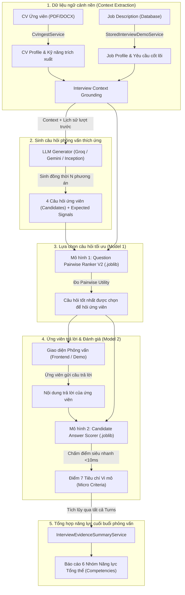

# TÀI LIỆU KIẾN TRÚC HỆ THỐNG AI & QUY TRÌNH HOẠT ĐỘNG
*(AI Workflow, Model Architecture & Integration Guide for Engineers & AI Agents)*

> **Dành cho:** Bất kỳ Kỹ sư Phần mềm (Frontend / Backend), Chuyên viên AI hoặc AI Assistant (Claude, Cursor, Copilot, ChatGPT) tiếp nhận dự án này để tiếp tục phát triển, tích hợp hoặc mở rộng hệ thống.

---

## 1. TỔNG QUAN HỆ THỐNG (SYSTEM OVERVIEW)

Dự án này là **Hệ thống Phỏng vấn Tuyển dụng Kỹ thuật Thích ứng bằng Trí tuệ Nhân tạo (Adaptive Technical Interview System)** thuộc nền tảng **NextStep**.

Mục tiêu chính:
1. **Cá nhân hóa theo ứng viên và vị trí**: Sử dụng hồ sơ CV (PDF/DOCX) và Bản mô tả công việc (Job Description - JD) làm dữ liệu ngữ cảnh nền tảng (Context Grounding) để sinh câu hỏi sát thực tế.
2. **Đánh giá phỏng vấn tự động & minh bạch**: Sử dụng 2 mô hình học máy (Machine Learning) được huấn luyện riêng biệt để:
   - **Xếp hạng & chọn câu hỏi chất lượng nhất** theo ngữ cảnh thời gian thực.
   - **Chấm điểm câu trả lời của ứng viên trên 7 tiêu chí vi mô** hoàn toàn cục bộ (offline, không phụ thuộc API bên ngoài).
3. **Tổng hợp năng lực ứng viên**: Đối chiếu toàn bộ các lượt hỏi - đáp trong buổi phỏng vấn để xuất báo cáo đánh giá **6 nhóm năng lực tổng thể**.

---

## 2. KIẾN TRÚC TOÀN CẢNH (END-TO-END WORKFLOW)

Quy trình hoạt động từ đầu vào CV/JD đến khi xuất kết quả đánh giá cuối cùng:



---

## 3. CHI TIẾT 2 MÔ HÌNH HỌC MÁY (MACHINE LEARNING ARTIFACTS)

Cả 2 mô hình đều nằm trong thư mục:
`artifacts/weak_supervision/v1_1/`

Chúng chạy **hoàn toàn cục bộ (In-Memory CPU Inference)**, không tốn phí gọi API, độ trễ chỉ **~5ms đến 15ms** mỗi lượt.

### 3.1. Mô hình 1: Xếp hạng câu hỏi phỏng vấn (Question Pairwise Ranker V2)
* **File mô hình**: `artifacts/weak_supervision/v1_1/question_pairwise_ranker_v2.joblib`
* **File đo đạc**: `artifacts/weak_supervision/v1_1/question_pairwise_ranker_v2_metrics.json`
* **Kiến trúc**:
  - Tiền xử lý: `TF-IDF Vectorizer` (n-gram 1-2, sublinear tf) trích xuất đặc trưng từ sự kết hợp của (Ngữ cảnh CV/JD + Giai đoạn phỏng vấn + Câu hỏi).
  - Thuật toán: **Pairwise Margin Ranking / Logistic Regression**.
* **Độ chính xác đo được**:
  - **Pairwise Ranking Accuracy: 88.08%**
  - **NDCG@1: 0.940**
  - **NDCG@3: 0.970**
* **Nhiệm vụ trong hệ thống**:
  Khi bộ sinh câu hỏi tạo ra 4 câu hỏi dự tuyển, mô hình này sẽ phân tích câu hỏi nào bám sát kỹ năng trong CV nhất, đào sâu đúng yêu cầu của Job nhất, và có tính phân loại năng lực ứng viên cao nhất để chọn ra câu hỏi chính thức.

### 3.2. Mô hình 2: Chấm điểm câu trả lời (Candidate Answer Scorer)
* **File mô hình**: `artifacts/weak_supervision/v1_1/candidate_answer_scorer.joblib`
* **File đo đạc**: `artifacts/weak_supervision/v1_1/candidate_answer_scorer_metrics.json`
* **Kiến trúc**:
  - Pipeline đa đầu ra (`MultiOutputRegressor` trên nền `Ridge Regression` với bộ từ khóa chuyên gia phỏng vấn).
  - Đối chiếu vector giữa **Câu hỏi + Tín hiệu kỳ vọng (`expected_signal`)** với **Câu trả lời của ứng viên**.
* **Độ chính xác đo được**:
  - **Macro R² Score: 0.923** (Giải thích được 92.3% phương sai điểm chuẩn).
  - **Sai số tuyệt đối trung bình (MAE): 0.230 điểm** (trên thang điểm 1.0 - 5.0).
* **Nhiệm vụ trong hệ thống**:
  Chấm điểm tự động và độc lập cho từng câu trả lời theo **7 tiêu chí vi mô**:
  1. `answer_relevance`: Trả lời đúng trọng tâm câu hỏi.
  2. `technical_correctness`: Tính chính xác về mặt kỹ thuật/công nghệ.
  3. `expected_signal_coverage`: Mức độ bao phủ các tín hiệu kỳ vọng trong JD.
  4. `reasoning_quality`: Tư duy lập luận, phân tích đánh đổi (trade-offs).
  5. `evidence_quality`: Có bằng chứng, số liệu, dự án thực tế chứng minh.
  6. `clarity_conciseness`: Diễn đạt rõ ràng, mạch lạc, súc tích.
  7. `consistency`: Tính nhất quán, không mâu thuẫn với nội dung CV.

---

## 4. PHÂN BIỆT 7 TIÊU CHÍ VI MÔ VÀ 6 NHÓM NĂNG LỰC TỔNG THỂ

Một điểm thiết kế quan trọng mà kỹ sư hoặc AI tiếp nhận cần nắm vững để không bị nhầm lẫn:

| Đặc điểm | 7 Tiêu chí Đánh giá Câu trả lời (Micro Criteria) | 6 Nhóm Năng lực Đánh giá Tổng thể (Macro Competencies) |
| :--- | :--- | :--- |
| **Phạm vi** | **Từng câu trả lời riêng lẻ** (Turn-by-turn). | **Toàn bộ buổi phỏng vấn** (Full session). |
| **Thực hiện bởi** | Mô hình ML `candidate_answer_scorer.joblib`. | Dịch vụ tổng hợp `InterviewEvidenceSummaryService`. |
| **Mục đích** | Đánh giá chất lượng kỹ thuật của câu trả lời ngay khi ứng viên vừa trả lời xong. | Tổng hợp hồ sơ năng lực cuối cùng để nhà tuyển dụng ra quyết định tuyển dụng. |
| **Danh sách tiêu chí** | 1. Độ liên quan<br>2. Độ chính xác kỹ thuật<br>3. Mức bao phủ tín hiệu kỳ vọng<br>4. Chất lượng lập luận<br>5. Bằng chứng thực tế<br>6. Độ mạch lạc súc tích<br>7. Tính nhất quán | 1. **Kiến thức chuyên môn** (*Technical Knowledge*)<br>2. **Bằng chứng kinh nghiệm thực tế** (*Experience Evidence*)<br>3. **Tư duy giải quyết vấn đề** (*Problem Solving*)<br>4. **Kỹ năng giao tiếp & truyền đạt** (*Communication*)<br>5. **Khả năng học hỏi & thích ứng** (*Learning Adaptability*)<br>6. **Mức độ sẵn sàng cho vai trò** (*Overall Readiness*) |

---

## 5. BẢN ĐỒ MÃ NGUỒN (CODEBASE DIRECTORY MAP)

Khi tiếp nhận dự án, bạn hãy xem các file chính sau:

```text
ai_job_server/
├── app/
│   ├── api/v1/endpoints/
│   │   ├── interview.py             <-- Cung cấp toàn bộ REST API phỏng vấn
│   │   ├── cv.py                    <-- Endpoint đọc & bóc tách CV
│   │   └── analyzer.py              <-- Endpoint so khớp CV & Job
│   │
│   ├── services/
│   │   ├── interview_service.py     <-- Engine phỏng vấn chính (sinh câu hỏi, prompt, flow)
│   │   ├── interview_model_service.py <-- Wrapper load & chạy 2 file .joblib
│   │   ├── interview_evidence_aggregation_service.py <-- Tổng hợp 7 tiêu chí thành 6 năng lực
│   │   ├── stored_interview_demo_service.py <-- Lấy CV/Job từ Supabase vào phiên phỏng vấn
│   │   ├── pdf_processor.py         <-- Bóc tách text, kỹ năng từ file CV PDF/Word
│   │   └── llm_provider_service.py  <-- Quản lý kết nối các LLM bên ngoài (Groq, Gemini...)
│   │
│   ├── static/
│   │   ├── index.html               <-- Giao diện Web demo phỏng vấn thời gian thực
│   │   └── demo.js                  <-- Logic Frontend tương tác trực tiếp với API
│   │
│   └── core/
│       └── config.py                <-- Đọc cấu hình từ file .env
│
├── artifacts/
│   └── weak_supervision/v1_1/       <-- Nơi chứa 2 file .joblib và các metrics JSON
│
└── docs/
    └── AI_WORKFLOW_AND_MODELS.md    <-- Tài liệu này
```

---

## 6. CÁC API ENDPOINTS QUAN TRỌNG ĐỂ TÍCH HỢP

Dành cho Frontend / Backend chính kết nối:

### 1. Lấy danh sách CV và Job có sẵn để chọn:
* **`GET /api/v1/interview/demo/options`**
* Trả về danh sách CV đã upload và danh sách Job đang có trên hệ thống.

### 2. Khởi tạo một phiên phỏng vấn mới:
* **`POST /api/v1/interview/demo/sessions`**
* **Payload**:
  ```json
  {
    "cv_id": "uuid-cua-cv",
    "job_id": "uuid-cua-job",
    "language": "vi",
    "max_questions": 5,
    "allow_external_ai": true
  }
  ```
* Hệ thống sẽ tự động bóc tách CV + Job, sinh 4 câu hỏi ứng viên, dùng Mô hình 1 chọn câu tốt nhất và trả về câu hỏi đầu tiên.

### 3. Gửi câu trả lời của ứng viên:
* **`POST /api/v1/interview/sessions/{session_id}/answers`**
* **Payload**:
  ```json
  {
    "answer": "Nội dung câu trả lời của ứng viên..."
  }
  ```
* Hệ thống sẽ dùng Mô hình 2 chấm ngay 7 tiêu chí, lưu kết quả và tự động sinh tiếp câu hỏi cho lượt kế tiếp.

### 4. Lấy báo cáo tổng hợp 6 nhóm năng lực:
* **`POST /api/v1/interview/sessions/{session_id}/evidence-summary`**
* Trả về điểm số (thang 1-5), nhận xét điểm mạnh, điểm yếu và các cờ cảnh báo (flags) cho toàn bộ buổi phỏng vấn.

### 5. Kiểm tra trạng thái nạp 2 mô hình AI:
* **`GET /api/v1/interview/realtime-models/status`**
* Kiểm tra xem 2 file `.joblib` đã được nạp thành công vào RAM hay chưa.

---

## 7. HƯỚNG DẪN CÀI ĐẶT & CHẠY DỰ ÁN CHO NGƯỜI TIẾP NHẬN

### Bước 1: Clone mã nguồn
```bash
git clone https://github.com/thinhgangg/prep-hire-ai.git
cd prep-hire-ai
```

### Bước 2: Thiết lập môi trường ảo Python
```powershell
python -m venv venv
.\venv\Scripts\activate
pip install -r requirements.txt
```

### Bước 3: Cấu hình file `.env`
Sao chép `.env.example` thành `.env`:
```powershell
Copy-Item .env.example .env
```
Điền 2 cấu hình quan trọng nhất:
1. `DATABASE_URL`: Đường dẫn kết nối cơ sở dữ liệu Supabase/PostgreSQL.
2. `GROQ_API_KEY` hoặc `GEMINI_API_KEY`: Chỉ cần **ít nhất 1 API key miễn phí** để gọi LLM sinh câu hỏi mới (phần chấm điểm thì chạy offline không cần key).

### Bước 4: Khởi chạy server
```bash
uvicorn app.main:app --reload
```

### Bước 5: Kiểm tra giao diện Demo có sẵn
Mở trình duyệt truy cập:
`http://127.0.0.1:8000/static/index.html`
Tại đây bạn có thể chọn CV, chọn Job, trả lời thử và xem trực quan điểm số chấm theo thời gian thực!

---

## 8. DANH MỤC VIỆC CẦN LÀM TIẾP THEO (NEXT STEPS FOR INTEGRATION)

Nếu bạn là kỹ sư tiếp nhận để hoàn thiện sản phẩm:
1. **Kết nối Frontend chính (React/Vue/Mobile)**: Gọi vào các API ở Mục 6 thay vì dùng giao diện demo HTML tĩnh.
2. **Speech-to-Text / Text-to-Speech (Tùy chọn)**: Nếu muốn ứng viên trả lời bằng giọng nói trực tiếp thay vì gõ phím, có thể thêm tầng Whisper / Web Speech API chuyển giọng nói thành text trước khi gửi vào endpoint `/answers`.
3. **Mở rộng mô hình (Fine-tuning)**: Nếu trong tương lai muốn cập nhật thêm dữ liệu huấn luyện mới, chạy script trong `scripts/` để export dataset và gọi `WeakSupervisionTrainingService` để tái huấn luyện ra phiên bản v1.2.
